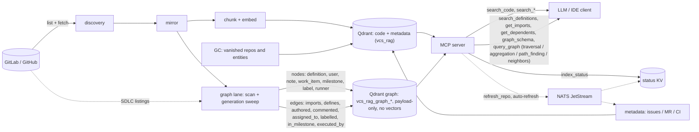

# vcs-rag

Self-hosted, VCS-agnostic RAG service over source code and repository metadata.
An alternative to GitLab Orbit: mirrors repositories (GitLab/GitHub), chunks
code, builds embeddings, and serves search via an MCP server.


One binary — two modes:

| Mode | Purpose |
|------|---------|
| `-mode=worker` | repository mirroring, chunking, embeddings, writes to Qdrant |
| `-mode=mcp` | MCP server for search over code/PRs/issues/CI failures |

## Quickstart (5 minutes)

Prerequisites: Docker with Compose v2 and ~2 GB of disk for the `bge-m3` model.

The demo is fully containerized — Qdrant, NATS, Ollama (with a one-shot
`bge-m3` pull), the worker and the MCP server — and needs no host networking.
Its default source is the public GitHub organization from
[`.env.example`](.env.example) (`GITHUB_ORG=gorizond`, no token).

```bash
# 1. create the environment (the example is demo-ready as-is)
cp .env.example .env

# 2. start the stack; the first run pulls the model (~1-2 min)
docker compose -f docker-compose.yml -f docker-compose.demo.yml up -d
```

```bash
# 3. verify: NATS JetStream is up …
curl -s http://127.0.0.1:8222/jsz | head -c 120     # → {"server_id":…}

# … and the MCP server answers the indexing-status tool:
SID=$(curl -sSD - -o /dev/null -X POST http://127.0.0.1:8080/mcp \
  -H 'Content-Type: application/json' -H 'Accept: application/json, text/event-stream' \
  -d '{"jsonrpc":"2.0","id":1,"method":"initialize","params":{"protocolVersion":"2025-06-18","capabilities":{},"clientInfo":{"name":"curl","version":"0"}}}' \
  | tr -d '\r' | awk -F': ' 'tolower($1)=="mcp-session-id"{print $2}')
curl -sS -X POST http://127.0.0.1:8080/mcp -H 'Content-Type: application/json' \
  -H 'Accept: application/json, text/event-stream' -H "Mcp-Session-Id: $SID" \
  -d '{"jsonrpc":"2.0","method":"notifications/initialized"}' >/dev/null
curl -sS -X POST http://127.0.0.1:8080/mcp -H 'Content-Type: application/json' \
  -H 'Accept: application/json, text/event-stream' -H "Mcp-Session-Id: $SID" \
  -d '{"jsonrpc":"2.0","id":2,"method":"tools/call","params":{"name":"index_status","arguments":{}}}'
# → data: {…"structuredContent":{"available":true,"repos_total":…}}
```

The status appears after the first discovery listing and the first status tick
(at most 60 s after startup) — until then `available:false` simply means the
worker has not published yet ([Indexing status](#indexing-status-index_status)).
Then point an MCP client at `http://127.0.0.1:8080/mcp`
([MCP integrations](#mcp-integrations)).

## Architecture



The background lanes (discovery → mirror → index → metadata, plus the GC and
graph lanes) keep the index fresh; the MCP server only reads Qdrant and, with
NATS, can pull one repository on demand ([refresh flow](docs/refresh.md)) or
refresh it automatically before a repo-scoped search (Auto freshness below).
The graph lane writes a separate **payload-only** collection
(`QDRANT_GRAPH_COLLECTION`, default `vcs_rag_graph`, instance-scoped) —
definition nodes, `imports`/`defines` edges and the Orbit-parity families
(user, note, work_item, milestone, label, runner) with their relations
(`authored`, `commented`, `assigned_to`, `labelled`, `in_milestone`,
`executed_by`), joined by canonical `node_key`/`from_key`/`to_key` refs and
carrying **no vectors** (zero embeddings). Stale generations are removed by a
mark-and-sweep GC after each successful repository scan
([graph layer](docs/graph.md)); the MCP serves both collections — the search
tools read code/metadata, the graph tools (`search_definitions`, `get_imports`,
`get_dependents`, `graph_schema`, `query_graph`) read the graph. Real-time CDC
is a non-goal — freshness comes from the periodic lanes (or an on-demand
refresh).

## Key environment variables

| Variable | Description |
|----------|-------------|
| `GITLAB_GROUP_ID` / `GITLAB_PROJECT_ID` / `GITLAB_TOKEN` | GitLab group(s) and/or explicit projects (comma-separated IDs or full paths) plus access token |
| `GITHUB_ORG` / `GITHUB_REPO` / `GITHUB_TOKEN` | GitHub organization(s) and/or explicit `owner/repo` references (comma-separated); the token is optional for public repos |
| `EMBEDDINGS_PROVIDER` / `EMBEDDINGS_MODEL` / `EMBEDDINGS_DIM` | `ollama` or `lm-studio`, model (default `bge-m3`), dimension (default `1024`) |
| `QDRANT_URL` / `QDRANT_COLLECTION` | Qdrant gRPC address and collection name |
| `MCP_TRANSPORT` / `MCP_ADDR` | `stdio` (default) or `sse`; address for sse |
| `WORKER_INTERVAL` / `WORKER_CONCURRENCY` | lane tick ceiling and the embeddings limiter ceiling (default 2) |
| `NATS_URL` / `NATS_INSTANCE_ID` | local JetStream (refresh/auto-freshness/status) and the instance scope |

The discovery set = (all projects of every configured group) ∪ (every
explicitly listed project/repo), deduplicated. If only the allowlist is set
(no group/org), index just those; an entry that cannot be fetched (404/403)
is logged as a WARN and skipped.

The complete reference — all 39 variables with defaults and secrets — is in
[`docs/env.md`](docs/env.md).

Switching GitLab ↔ GitHub is env-only: the core does not change (both providers
share one interface and pass one contract suite).

GitHub works **without a token** for public organizations (anonymous API limit —
60 requests/hour per IP); a token without scopes is recommended for the
metadata lane (issues/MRs), and `WORKER_DISCOVERY_MIN_INTERVAL` can pin the
repository listing to at most one API call per window (e.g. `10m`). GitLab
still requires `GITLAB_TOKEN`.

Metadata (issues, MR/PR, CI failures) is indexed incrementally: a point is
re-embedded only when its source `updated_at` changed; a CI job is indexed once
(a rerun gets new `(pipeline, job)` ids); the first pass over a repository is
full. Deleting `*.state.json` resets this cache ([`docs/reindex.md`](docs/reindex.md)).

`git fetch` runs on the mirror lane only (`WORKER_MIRROR_INTERVAL`); the index
lane reads the local mirror — network access only for the initial clone.

With `NATS_URL` set, the MCP adds the `refresh_repo` tool: the LLM can pull one
repository's fresh commits and metadata before searching (the worker executes
the task from the local JetStream). `NATS_INSTANCE_ID` scopes the consumer,
subject and KV bucket, so several deployments can share one NATS server — see
[`docs/refresh.md`](docs/refresh.md) for the full flow, semantics and limits.

## Adaptive tuning

The worker tunes itself to one local embeddings model — no manual env edits or
restarts after the initial deploy:

- **AIMD embeddings limiter**: every worker-side embedding call (background
  lanes and the refresh path) goes through a concurrency limiter that starts at
  1 and grows additively (+1 after 10 consecutive fast successes, ≤10 s each)
  up to the ceiling `WORKER_CONCURRENCY` (default **2**). An overload signal
  (HTTP 429/5xx, timeouts, a refused connection, Ollama "no models loaded")
  halves the limit and opens an exponential cooldown (5 s → 10 s → … capped at
  60 s).
- **Adaptive lane pacing**: `WORKER_*_INTERVAL` values are ceilings, not fixed
  ticks. A busy pass retries after ≥5 s; an idle lane backs off exponentially up
  to its ceiling; a VCS rate limit (`429`/`Retry-After`) dominates the delay
  (30 s floor, 5 min cap). All delays get ±25 % jitter.
- The current limit, latency p50/p95, throttle count, and the next pace delay
  with its reason are printed in the per-pass summary.

## Auto freshness

With `NATS_URL` set, a repository-scoped search refreshes itself when the index
looks stale — the LLM does not have to call `refresh_repo`:

- before searching, the MCP reads the status KV: a `done` younger than **10 min**
  is fresh (no task); a live `in_progress` younger than 15 min is awaited;
  otherwise an `origin:"auto"` task is published and the search waits for the
  correlated result;
- the extra latency is capped at **+3 s**, and the search proceeds regardless of
  the refresh outcome;
- anti-DDoS budgets: one publication per repository per **5 min** plus a global
  fixed window of **6/min** and **60/h**; publications get a 0–300 ms jitter;
- the worker handles an `auto` task gently: the metadata phase is skipped when
  `MetaSyncedAt` is younger than **1 h** (the background metadata lane still
  covers it);
- the `repo` filter accepts the full `namespace/path` **or a short form**
  (e.g. `nats`, `secrets/runner`): the MCP resolves it against the instance
  repository list and normalizes it into the stored payload pair
  `(group_org=<namespace>, repo=<path>)`; 2–16 candidates become an OR. An empty
  `NATS_URL` disables only the auto-refresh; the filter normalization keeps
  working.

## Garbage collection

**Discovery is the source of truth**: a repository or metadata entity that has
disappeared from the provider is removed from the index by the GC lane. The
default `WORKER_GC_DRY_RUN=true` is the permanent kill-switch — the lane only
logs `gc would-delete` until it is disabled explicitly. Details and the journal
formats — [`docs/gc.md`](docs/gc.md).

- **Repo GC** (`WORKER_GC_INTERVAL`, default **15m**): a repository absent from
  two consecutive listings and for at least **10 min** since its first miss is
  counted, then deleted — Qdrant points (`DeleteRepoPoints`, with a count in
  the journal), the mirror, the state sidecar and the registry entry. Caps:
  **10 deletions per pass**, oldest disappearance first; a busy repository
  (refresh/mirror/index in flight) is skipped.
- **Anomaly guard**: an empty snapshot, a snapshot dropped by **>30%** (with at
  least 10 known repositories) or a stale listing (>max(3×`WORKER_INTERVAL`,
  10m)) freezes the streaks for up to **3** consecutive passes — a bad provider
  day must not nuke the index. A vanished whole namespace is logged as a WARN.
- **Entity GC** (the metadata pass): a full issue/MR listing marks vanished
  `issue:`/`mr:` keys; after **2** consecutive misses the point is deleted by
  ID — no extra API calls. Caps: **32 per repository** and **128 per pass**;
  CI keys are owned by the existing CI prune and are untouched.
- **Orphan mirrors** (a mirror whose namespace is not in the discovery) are
  WARN-ed, never deleted. The lane is observational in dry-run: the pass
  summary reports `gc_dry_run`, `gc_anomaly`, `gc_deleted_repos/points` and the
  suppression counters.

## Embeddings

The target model is **`bge-m3`** (dim 1024, COSINE): in Ollama
(`ollama pull bge-m3`) or in LM Studio (GGUF build, e.g. `lm-kit/bge-m3-gguf`;
the local server is enabled in the UI). The providers are interchangeable —
switching is env-only; the Qdrant collection name is `QDRANT_COLLECTION`
(default `vcs_rag`). A different model/dimension only via the reindex procedure
([`docs/reindex.md`](docs/reindex.md)). For LM Studio:
`EMBEDDINGS_PROVIDER=lm-studio`,
`EMBEDDINGS_BASE_URL=http://localhost:1234`,
`EMBEDDINGS_MODEL=<identifier from LM Studio>`, `EMBEDDINGS_DIM=1024`.

## Running

The supported deployment path is Compose. Copy [`.env.example`](.env.example)
to `.env`, keep exactly one VCS flavor active, then:

```bash
docker compose up -d          # "Deploy example": host Ollama/LM Studio
# or the fully containerized demo (see Quickstart):
docker compose -f docker-compose.yml -f docker-compose.demo.yml up -d
```

Both stacks publish everything on `127.0.0.1` only. Building the image locally
(or using the published `ghcr.io/gorizond/vcs-rag`):

```bash
docker build -t vcs-rag:dev .
docker run --rm vcs-rag:dev -version   # → vcs-rag <version>
```

For a one-off container the worker needs reachable Qdrant and embeddings
endpoints; with Docker on Linux the host is reached via
`host.docker.internal` (no host networking needed):

```bash
docker run --rm \
  -e GITHUB_ORG=<org> -e EMBEDDINGS_PROVIDER=ollama \
  -e EMBEDDINGS_BASE_URL=http://host.docker.internal:11434 \
  -e QDRANT_URL=http://host.docker.internal:6334 \
  -v "$PWD/mirrors":/mirrors \
  --add-host=host.docker.internal:host-gateway \
  vcs-rag:dev -mode=worker
```

`--network host` is only a production nuance when the embeddings service must
be reached on the host's loopback — the compose stacks avoid it entirely.

Private repositories: the token is passed to git processes through the
environment (`http.extraHeader`, Basic: GitLab `oauth2:<token>`, GitHub
`x-access-token:<token>`) — it is not stored in the clone URL or the mirror's
`.git/config`; local git operations run without the token.

## Deploy example

`docker-compose.yml` (repository root) brings up the whole stack — worker, MCP
search, Qdrant and a local NATS JetStream:

```bash
cp .env.example .env    # then edit: one provider flavor, host Ollama/LM Studio
docker compose up -d
```

- The embeddings endpoint points at your Ollama/LM Studio
  (`EMBEDDINGS_BASE_URL`, default `http://host.docker.internal:11434`; on Linux
  the compose file adds `host.docker.internal:host-gateway`).
- MCP is exposed on `http://127.0.0.1:8080/mcp` (`MCP_TRANSPORT=sse`).
- `NATS_URL` enables `refresh_repo`, auto-freshness and `index_status`;
  `NATS_INSTANCE_ID` allows several deployments on one NATS server.
- All values in the compose file are `${ENV}` placeholders or example values —
  no real tokens, groups or private endpoints belong in the repository.

## MCP integrations

The server speaks stdio (`-mode=mcp`) and streamable HTTP
(`MCP_TRANSPORT=sse MCP_ADDR=:8080` → `http://127.0.0.1:8080/mcp`); the
compose stacks publish the HTTP endpoint on loopback. All clients below assume
that URL; for remote access put a reverse proxy with TLS/auth in front
([Security](#security)).

**opencode** (`mcp.servers` in the config):

```json
{"mcp":{"servers":{"vcs-rag":{"type":"remote","url":"http://127.0.0.1:8080/mcp","enabled":true}}}}
```

**Cursor** (`~/.cursor/mcp.json` or `.cursor/mcp.json`):

```json
{"mcpServers":{"vcs-rag":{"url":"http://127.0.0.1:8080/mcp"}}}
```

Add `headers` (e.g. `{"Authorization":"Bearer <token>"}`) when the endpoint is
proxied with auth.

**Claude Desktop** (`claude_desktop_config.json`) — run the stdio mode locally:

```json
{"mcpServers":{"vcs-rag":{"command":"docker","args":[
  "run","-i","--rm",
  "-e","GITLAB_GROUP_ID=1","-e","GITLAB_TOKEN=dummy",
  "-e","EMBEDDINGS_PROVIDER=ollama",
  "-e","EMBEDDINGS_BASE_URL=http://host.docker.internal:11434",
  "-e","QDRANT_URL=http://host.docker.internal:6334",
  "--add-host=host.docker.internal:host-gateway",
  "ghcr.io/gorizond/vcs-rag:latest","-mode=mcp"]}}}
```

Search needs no VCS access: provider envs are required only for config
validation (dummy is fine). For the HTTP endpoint use **Settings →
Connectors** (Remote MCP) — Claude Desktop does not take remote servers from
the JSON file.

**VS Code** (`.vscode/mcp.json` or the user `mcp` settings):

```json
{"servers":{"vcs-rag":{"type":"http","url":"http://127.0.0.1:8080/mcp"}}}
```

**Gotcha:** clients cache the tool list at connect time — after upgrading the
server image (a new version adds tools), **restart the client**; a plain
reconnect may keep the old list. The complete list is the tool table below;
calling `index_status` is the quickest connectivity check.

**Tools.** The search tools plus the graph tools (which read the separate
payload-only graph collection, [`docs/graph.md`](docs/graph.md)) and the
worker/NATS tools:

| Tool | Purpose |
|------|---------|
| `search_code` | semantic code search |
| `search_pull_requests` | semantic MR/PR search; optional `state` (open/merged/closed/locked/draft), `label`, `author`, `milestone` filters. With `file_path`: exact lookup of the MRs/PRs that changed the file, each with its per-file diff chunks (`file_path`, `status`, `patch`, `patch_truncated`); repo is required and `query` is not used in this mode |
| `search_issues` | semantic issue search; same `state`/`label`/`author`/`milestone` filters |
| `search_ci_failures` | semantic search over failed CI job logs |
| `search_definitions` | symbol definitions from the graph; `mode=auto` (default) tries name matching first, then falls back to the semantic code search; `name` matches the symbol exactly or as a full-text token (no substring/prefix) |
| `get_imports` | direct 1-hop package imports of a file or package (`direction=outgoing` default: what the input imports) |
| `get_dependents` | direct 1-hop importers (`direction=incoming` default). **Package-level, not symbol-level**: the dependents of file X are the importers of X's package(s), not symbol referencers |
| `query_graph` | graph query family (`mode` = `traversal` default / `aggregation` / `path_finding` / `neighbors`, see below); traversal: start entity (`definition`/`file`/`mr_file`/`ci`/`vuln`/`user`/`note`/`work_item`/`milestone`/`label`/`runner`) + filters, optional edge selector (`imports`/`defines`/`authored`/`commented`/`assigned_to`/`labelled`/`in_milestone`/`executed_by`/`*`), hops 1–3, limit ≤1000. Requires at least one selective predicate, else `non_selective_query`; caps set `truncated: true` |
| `graph_schema` | self-describing graph schema: node/edge/entity types, query DSL version/operators, per-repo coverage markers |
| `index_status` | worker indexing status (below) |
| `refresh_repo` | on-demand refresh of one repository (registered only with `NATS_URL` set) |

### Graph query modes (`query_graph`)

`mode` selects the query family — `traversal` (default, above), `aggregation`,
`path_finding` or `neighbors` (all four are declared by
`graph_schema` → `query_dsl.modes`). Canonical keys identify a graph point:
`repo|file:<path>`, `repo|pkg:<package>`, `user:<host>#<id>`,
`repo|note#<id>`, `repo|wi:<type>#<iid>`, `repo|ms#<id>`,
`lab:<scope>|<name>`, `runner:<host>#<id>`; see the
[query DSL](docs/graph.md#query-dsl-query_graph). Every mode carries the
coverage notice and `truncated`.

- **aggregation** — grouped counts/values: `op` (`count` default; `sum`,
  `avg`, `min`, `max` need `field`), `group_by` (comma = composite key),
  `sort` (`key`/`count`/`value`, prefix `-` for descending) and `limit`
  (default 30, max 1000). Ungrouped `count` is exact; the fold caps the scan
  at **50 000** points and **10 000** groups (`MCP_GRAPH_AGG_MAX_*`). A fold
  cut returns partial values with `truncated: true`; an exact grouped count
  beyond the group cap is refused with `aggregation_cap_exceeded`.
- **path_finding** — the shortest path between the canonical `from`/`to`
  keys; `rel_types` (edge types) is **required**, `max_depth` is 1..3 (`hops`
  is the alias). `status` is honest: `found`, `not_found`, or `inconclusive`
  when a cap/coverage gap cut the search — never reported as `not_found`.
- **neighbors** — the 1-hop peers of `node_key`: `direction` = `outgoing`
  (default) / `incoming` / `both`, optional `rel_types`. A peer without a
  stored node is a pseudo-node (`resolved: false`, no payload); a resolved
  peer carries its node.

## Indexing status (`index_status`)

The tool answers with an object built from the `worker_status_<id>` KV snapshot
the worker publishes at most once per minute (only with `NATS_URL` set):

- `available` — `true` when a snapshot is present; otherwise `reason` explains
  it (`NATS is not configured`, `no worker status published yet` — the first
  tick has not happened, `worker status is unreadable`);
- `repos_total` / `repos_indexed` / `repos_pending` — discovery size vs
  repositories with at least one indexed commit in their state sidecar;
- `pending_sample` — up to 10 sorted names of the pending repositories;
- `points` — the exact Qdrant point count (omitted when the count failed);
- `last_pass` — the counters of the last **completed** index pass
  (`repos`, `ok`, `errors`, `indexed_commits`, `resumed`, `skipped`, `pruned`,
  `duration_ms`); the field is omitted until the first pass completes, so a
  long backfill still reports fresh totals without it;
- `updated_at` — when the snapshot was built.

The published value lives in `worker_status_<instance id>` (key `status`, TTL
24 h); the refresh contract in `refresh_status_<id>` is untouched.

## Troubleshooting

1. **`connection refused` from the worker to the embeddings endpoint** — the
   stack uses the *host* Ollama/LM Studio (`EMBEDDINGS_BASE_URL`, default
   `http://host.docker.internal:11434`). On Linux the compose file adds
   `host.docker.internal:host-gateway`; without a host Ollama use the
   self-contained demo (`docker-compose.demo.yml`). Check the model is pulled:
   `ollama pull bge-m3`.
2. **`dimension … expected …`** — the collection was built with another
   `EMBEDDINGS_DIM`/model; follow [`docs/reindex.md`](docs/reindex.md).
3. **`index_status` → `available:false`** — with `NATS_URL` empty the tool
   always reports `NATS is not configured`; otherwise the worker publishes at
   most once per minute, so wait a tick. `no worker status published yet` for
   minutes means the worker is not running or its discovery snapshot is still
   empty (nothing is published until the first listing arrives).
4. **HTTP `429` / `Retry-After`** — the provider's rate limit (anonymous GitHub:
   60 requests/hour per IP). The lanes back off by themselves (Adaptive
   tuning); for less pressure use a provider token and/or
   `WORKER_DISCOVERY_MIN_INTERVAL=10m`.
5. **Tools missing in the client after an upgrade** — clients cache the list;
   restart the client (see the integrations gotcha).

## Security

- **Loopback by default**: the compose stacks publish Qdrant, NATS and MCP on
  `127.0.0.1`; the MCP server has no built-in authentication.
- **The graph has no per-user ACL**: per-user authorization is an explicit
  punt — `MCP_AUTHZ_ENABLED` is a reserved no-op and nothing filters results by
  user; the query tools serve the instance's whole graph to a trusted loopback
  consumer ([graph layer](docs/graph.md#authz-and-freshness-scope)).
- For remote clients expose only the MCP endpoint through a reverse proxy with
  **TLS and auth** (e.g. an ingress with basic auth / an OIDC proxy); keep
  Qdrant and NATS private.
- `QDRANT_API_KEY` for Qdrant Cloud or any reachable-remotely Qdrant instance.
- Secrets (VCS tokens, `QDRANT_API_KEY`) live in `.env`/the orchestrator's
  secret store; the repository contains placeholders only. Git tokens travel in
  the process environment and never reach clone URLs or mirror configs.
- GC runs with `WORKER_GC_DRY_RUN=true` until you deliberately disable it —
  deletions are journalled ([`docs/gc.md`](docs/gc.md)).

## Scaling and multiple instances

One deployment is defined by the triple `QDRANT_COLLECTION` +
`NATS_INSTANCE_ID` + `MIRRORS_DIR` — keep it unique per instance. Several
instances can share one NATS server (the stream is common; consumer, subjects
and the `refresh_status_<id>`/`worker_status_<id>` buckets are scoped by the
instance id), and every MCP server answers for the instance it is configured
with. `index_status`, refresh and auto-freshness are per-instance.

## Backup and restore

- **Qdrant** — the index of record. Use Qdrant snapshots
  (`POST /collections/<name>/snapshots`, plus the volume `qdrant-data`); restore
  by creating the collection and uploading the snapshot (or copying the volume
  while stopped).
- **`mirrors/` volume** — bare mirrors, `*.state.json` sidecars and
  `.gc_registry.json`. Optional: everything can be re-cloned and re-indexed
  from the provider, but the sidecars avoid re-embedding unchanged code and
  keep the incremental caches.
- **NATS `nats-data`** — ephemeral: the status/refresh KV entries have a 24 h
  TTL and the topology is re-provisioned at worker startup. No backup needed.
- Keep `.env` in your secret backup (it holds the tokens, not the index).

## Release

Images — `ghcr.io/gorizond/vcs-rag:<tag>` (semver tags without the `v` prefix,
e.g. `0.0.1`/`0.0`/`0`, and `latest`; rc tags — version only + Pre-release, they
do not move `latest`); the version is baked in at build time (`--build-arg
VERSION=...` from the git tag name, release workflow):

```bash
docker pull ghcr.io/gorizond/vcs-rag:0.0.1
docker run --rm ghcr.io/gorizond/vcs-rag:0.0.1 -version   # → vcs-rag v0.0.1
```

## Maintenance

- All environment variables — [`docs/env.md`](docs/env.md).
- Refresh semantics — [`docs/refresh.md`](docs/refresh.md); garbage collection —
  [`docs/gc.md`](docs/gc.md); the graph collection, mark-and-sweep GC and query
  DSL — [`docs/graph.md`](docs/graph.md); changing the embeddings model/dimension —
  [`docs/reindex.md`](docs/reindex.md).
- Validation SC-001…SC-009 and the performance baseline — `tests/integration/final-validation.md`,
  `tests/integration/perf-baseline.md`.

Full contracts (CLI, MCP tools, Qdrant schema) live in the project spec-kit
(0_WORK repository), see `contracts/cli.md` in the specification.

## License

MIT — see [`LICENSE`](LICENSE).
